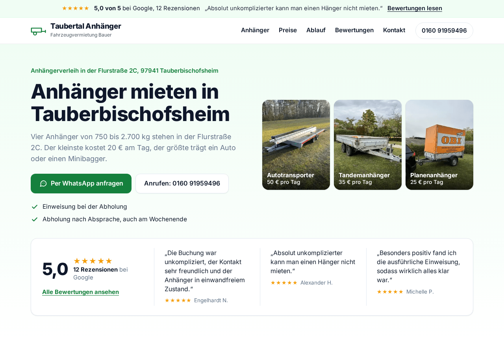
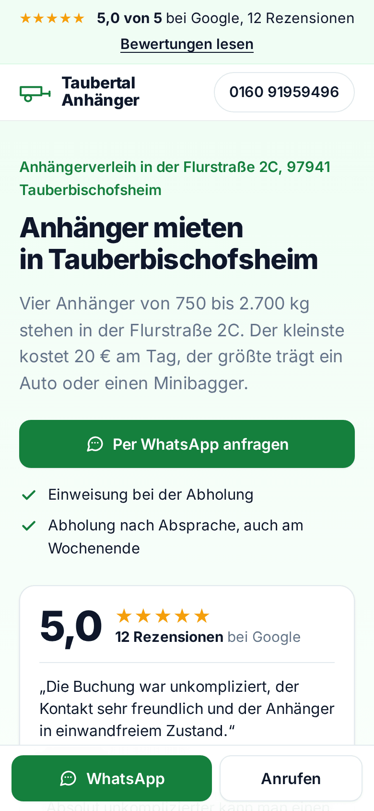
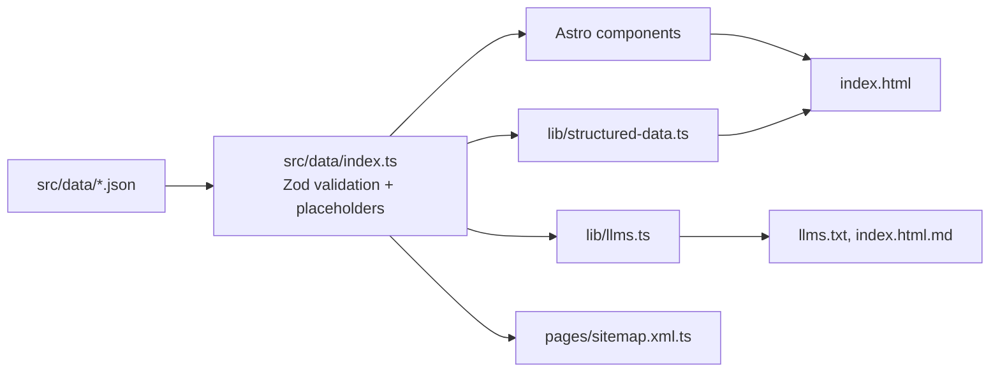

# Taubertal Anhänger

Website for a small trailer rental business in Tauberbischofsheim, Germany. One landing page with four rental
trailers, prices, FAQ and contact via WhatsApp or phone. Static, fast, no cookies, no third-party requests.

Built as a freelance project for a real client, so the page content is German; code and documentation are English.

**Live preview:** [teifler.github.io/taubertal-anhaenger](https://teifler.github.io/taubertal-anhaenger/), deployed from
`main` by CI after all checks pass. The preview is `noindex`; the production site will run on its own domain.

| Desktop                                               | Mobile                                                                         |
| ----------------------------------------------------- | ------------------------------------------------------------------------------ |
|  |  |

## Highlights

- **One source of truth.** Every price lives in [`src/data/trailers.json`](src/data/trailers.json). Content files
  reference it with placeholders such as `{day:autotransporter}`; all data is validated with Zod when the build starts,
  and a typo in a placeholder or a hard-coded `€` amount in the content fails the build or the tests.
- **Many outputs from the same data.** The page, schema.org JSON-LD (`LocalBusiness` with one `Offer` per trailer,
  `FAQPage`), an image sitemap, `robots.txt`, and [`llms.txt`](https://llmstxt.org) plus a Markdown version of the
  page for AI assistants.
- **Small.** 14.6 KB of gzipped HTML including all CSS, 0.6 KB of JavaScript (one progressively enhanced photo
  gallery), a self-hosted variable font, responsive WebP images generated at build time.
- **Accessible.** Checked against WCAG 2.2 AA with axe on desktop and mobile in CI. Keyboard-scrollable galleries,
  skip link, visible focus, `prefers-reduced-motion`.
- **Private and secure by default.** No cookies, no embeds (Maps and WhatsApp are links), a hash-based Content
  Security Policy without `'unsafe-inline'`, security headers, and licence plates redacted from all photos.

## Tech stack

[Astro 7](https://astro.build) · TypeScript (strict) · Zod · Vitest 5 with the Astro Container API · Playwright with
axe-core · ESLint 10 (typescript-eslint, eslint-plugin-astro, jsx-a11y) · Prettier · GitHub Actions · Node 26 LTS

## Getting started

```sh
nvm use          # Node 26, see .nvmrc
npm ci
npm run dev      # http://localhost:4321
```

| Script                            | What it does                                                       |
| --------------------------------- | ------------------------------------------------------------------ |
| `npm run build`                   | Static build into `dist/`                                          |
| `npm run preview`                 | Serve `dist/` locally                                              |
| `npm run check`                   | Type-check `.astro` and `.ts` files (`astro check`)                |
| `npm run lint` / `lint:fix`       | ESLint incl. accessibility rules                                   |
| `npm run format` / `format:check` | Prettier                                                           |
| `npm test`                        | Unit and component tests (Vitest)                                  |
| `npm run test:e2e`                | Builds, serves and runs Playwright on desktop Chrome and a Pixel 7 |
| `npm run validate`                | Everything above, in the order CI runs it                          |

First e2e run: `npx playwright install chromium`.

## How it works



```
src/
├── data/          JSON content + index.ts (schemas, validation, placeholder resolution)
├── lib/           Pure functions: formatting, pricing, placeholders, links, JSON-LD, llms.txt
├── components/    One component per page section, styles scoped to the component
├── layouts/       BaseLayout: <head>, meta tags, header/footer
├── pages/         index, legal pages, 404, and the text endpoints (sitemap, robots, llms)
└── styles/        global.css: design tokens and the few shared patterns
tests/
├── unit/          Vitest: lib functions, data integrity, PriceTable rendered via Container API
└── e2e/           Playwright: SEO tags, links, gallery, layout, axe, endpoints, 404
scripts/           redact-plates.mjs (blurs licence plates in the photos)
```

## Testing

**Unit tests** cover the logic that would silently produce wrong content: the placeholder resolver (including every
failure case), price formatting, data integrity (all images exist, use cases point to real trailers, no hard-coded
euro amounts in content files), the JSON-LD graph, `llms.txt`, and a Markdown snapshot of the whole page.

**End-to-end tests** run against the production build on a desktop and a mobile viewport: SEO tags, that every
in-page link has a target, that JSON-LD offers match the trailer cards, no console errors (which also catches CSP
violations), gallery navigation by mouse and keyboard, responsive layout, axe scans of every page, and the generated
text endpoints.

## Decisions and trade-offs

- **Astro without a UI framework.** The only interactive part is the photo gallery; a 0.6 KB script is enough, and
  without JavaScript the gallery still works as a swipeable, keyboard-scrollable strip.
- **Validated JSON instead of content collections.** Six small files that components, endpoints and tests all import
  synchronously. Content collections would add async loading for no benefit at this size.
- **Placeholders instead of templating the FAQ in code.** The client can still edit full sentences in `faq.json`; only
  the numbers come from the data.
- **Content date instead of build date** for `dateModified` and sitemap `lastmod`, so rebuilding does not claim the
  content changed and builds are reproducible.
- **No `AggregateRating` markup.** Google does not show review stars a business publishes about itself.
- **One codebase, two deploy targets.** Production builds for the real domain; the GitHub Pages preview sets
  `DEPLOY_TARGET=github-pages` and serves the same build from `/<repo>/`. Internal links go through `withBase()`,
  a unit test rejects root-relative links, and the preview is `noindex` so it never competes with the real domain.
- **WhatsApp and phone instead of a booking form.** No backend, no personal data stored, and it matches how the
  business already works.

## Status

The site is finished but not live yet. Before launch the client still has to provide the details for the privacy policy
(still a placeholder) and confirm a few facts. Both legal pages are
`noindex` on purpose.

## Inhalte pflegen (für den Betreiber)

| Was                                                                                    | Datei                                                |
| -------------------------------------------------------------------------------------- | ---------------------------------------------------- |
| Anhänger, technische Daten, Preise, Kaution                                            | `src/data/trailers.json`                             |
| Name, Inhaber, Adresse, Telefon, E-Mail, USt-IdNr., W-IdNr., Title, Description, Texte | `src/data/site.json`                                 |
| Fragen und Antworten                                                                   | `src/data/faq.json`                                  |
| Google-Zitate                                                                          | `src/data/reviews.json`                              |
| Ablauf, „Welcher Anhänger wofür“                                                       | `src/data/steps.json`, `src/data/use-cases.json`     |
| Fotos                                                                                  | `src/assets/images/`, eingetragen in `trailers.json` |
| Domain                                                                                 | `astro.config.mjs` (`site`) und `public/.htaccess`   |

Preise nur in `trailers.json` ändern. In anderen Texten stehen Platzhalter, die beim Build ersetzt werden:
`{day:<id>}`, `{weekend:<id>}`, `{fiveDays:<id>}`, `{week:<id>}`, `{deposit:<id>}`, `{note:<id>}`, `{minPrice}`,
`{phone}`, `{street}`, `{city}`. Ein Tippfehler darin bricht den Build mit einer klaren Meldung ab.
Danach `npm run validate` und den Inhalt von `dist/` hochladen. Die `.htaccess` gilt nur auf Apache-Servern.

## Content rights

Business content, photos and branding belong to Fahrzeugvermietung Bauer and are not licensed for reuse.
